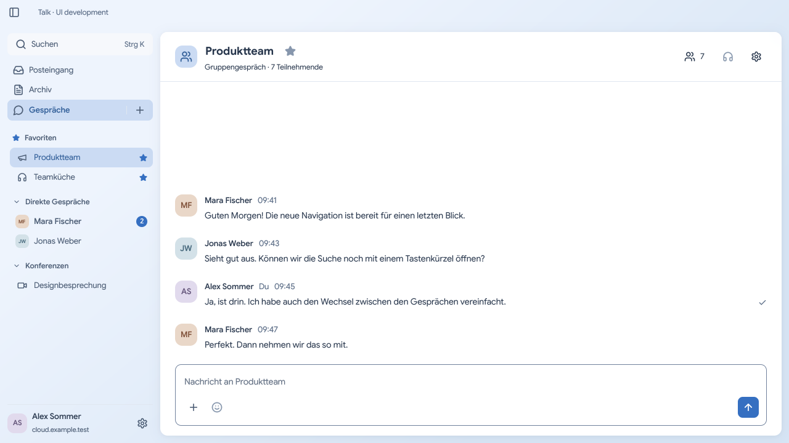

# NextCloud Modern Talk

A native desktop client for teams using NextCloud Talk, built in Rust with GPUI and no WebView. It brings conversations, messages, files and calls together, with Google Sans typography, blue and sage accents, and system, light and dark appearance.

The target server families are **NextCloud 34 / Talk 24** and **NextCloud 35 / Talk 25**. Availability depends on server capabilities, configuration and permissions. macOS is the first product target; Linux is a development and packaging target.

The alpha includes browser-based account connection, conversation settings, messaging, previews, polls, background activity, audio/video calls and automatic update downloads. The macOS DMG includes its media runtime; no separate GStreamer installation is needed. The native UI uses Lucide icons, contextual chat actions and subtle transitions that respect Reduce Motion. Download an [alpha release](https://github.com/adapt2move/nextcloud-modern-talk/releases) and follow the [installation guide](docs/install.md), including the macOS first-launch approval. See the [changelog](docs/changelog.md) for recent changes and [known limitations](docs/limitations.md) for remaining gaps.

The untouched screenshot shows the native Linux app connected to a disposable
NextCloud Talk server, with an English interface, fictional team members and
German messages. The image card is an actual shared attachment.

## Contribute

Start with [Contributing](CONTRIBUTING.md) and the [development guide](docs/development.md) for prerequisites, the pinned toolchain and scoped commands. UI scenarios use fictional data and do not log into a server. The [backend lab](docs/backend-lab.md) uses Docker and synthetic accounts.

With prerequisites and [Go Task](https://taskfile.dev/docs/installation) installed,
run `task dev` to build and start the debug app, or `task build` for an optimized
release binary. `task --list` shows the other development commands. See the
[development guide](docs/development.md#native-ui-entrypoint) for preview and
packaging commands.

## Documentation

- [Product requirements](docs/product/README.md) and [feature inventory](docs/compatibility/feature-inventory.md)
- [Architecture](docs/architecture/README.md) and [design reference](docs/design/README.md)
- [CI policy](docs/ci.md) and [release tooling](tools/release/README.md)
- [Documentation index](docs/README.md) and [security reporting](SECURITY.md)

Licensed under [EUPL-1.2](LICENSE); third-party assets retain their [notices and licenses](NOTICE.md). This is an independent project, not an official NextCloud client.
