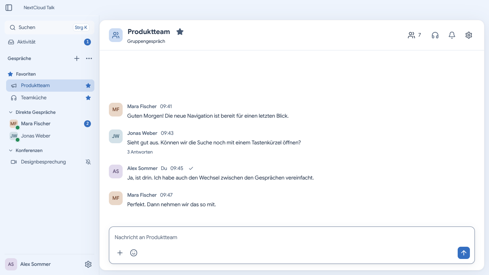
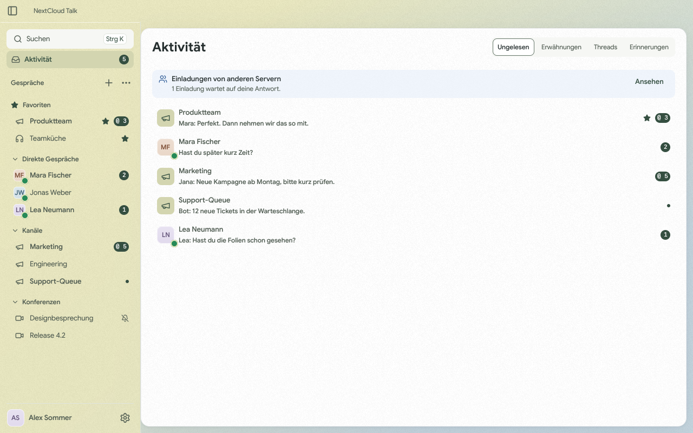
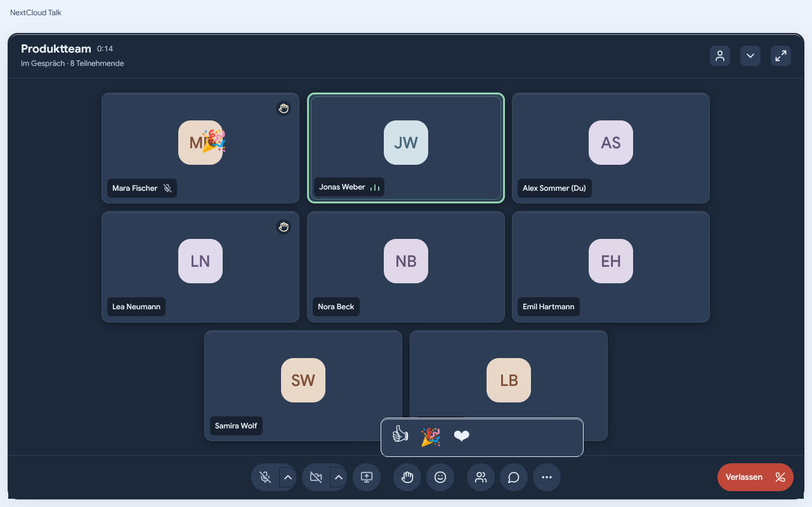

<div align="center">

# NextCloud Modern Talk

**A fast, native desktop client for NextCloud Talk.**<br>
Built in Rust with GPUI: no WebView, no Electron.

[](https://github.com/adapt2move/nextcloud-modern-talk/releases)
[](LICENSE)


[**Download**](https://github.com/adapt2move/nextcloud-modern-talk/releases) ·
[Install guide](docs/install.md) ·
[Release notes](https://github.com/adapt2move/nextcloud-modern-talk/releases) ·
[Known limitations](docs/limitations.md)

<br>

<picture>
  <source media="(prefers-color-scheme: dark)" srcset="docs/assets/chat-dark.png">
  
</picture>

</div>

## Why Modern Talk

Your team's conversations, files and calls in one calm, fast workspace. Modern Talk
works with your existing NextCloud server and keeps up even when the server is slow.

- **Calm navigation.** Search with a quick switcher (<kbd>⌘</kbd> <kbd>K</kbd>), one
  Activity view for unread messages, mentions, threads and reminders, and a
  conversation list with favorites and sections.
- **Everything in the conversation.** Threads, replies, reactions, mentions,
  Markdown, polls, voice messages, link previews, reminders and scheduled messages.
- **Your NextCloud files.** Browse and share files from your NextCloud, or paste and
  drop them into a conversation.
- **Calls that just start.** Audio and video calls with screen sharing, raised hands
  and reactions, with internal signaling or the High Performance Backend.
- **Offline-first.** Starts instantly from its cache. Drafts and queued changes
  survive restarts, and the connection status stays quietly in the title bar.
- **Made for daily use.** Presence and typing indicators, notifications, multiple
  accounts, light and dark appearance, blue or sage accents, and an English,
  German and Spanish interface.

## A closer look

<table>
  <tr>
    <td width="50%"></td>
    <td width="50%"></td>
  </tr>
  <tr>
    <td align="center"><sub><b>Activity</b>: unread messages, mentions, threads and reminders in one place</sub></td>
    <td align="center"><sub><b>Calls</b>: gallery, raised hands, reactions and screen sharing</sub></td>
  </tr>
</table>

<sub>All screenshots are Linux/X11 captures of the compiled app with fictional team data
and the German interface. They come from development scenarios that are not connected to a server.</sub>

## Get started

| Platform | Status | Package |
| --- | --- | --- |
| macOS (Apple Silicon) | Primary target | DMG with the media runtime included |
| Linux (x86_64) | Supported for development and packaging | `.deb` and `.tar.gz` |
| Windows | Compile-checked only | — |

Download the latest alpha from the [releases page](https://github.com/adapt2move/nextcloud-modern-talk/releases)
and follow the [installation guide](docs/install.md) for the first launch on macOS
and for updates.

Modern Talk targets **NextCloud 34 / Talk 24** and **NextCloud 35 / Talk 25**.
Available features depend on your server's capabilities, configuration and
permissions.

> [!NOTE]
> This is alpha software. Read the [known limitations](docs/limitations.md) before
> relying on it as your only Talk client, for example: calls that require
> end-to-end encryption are not supported yet.

## Contribute

Read [Contributing](CONTRIBUTING.md) and the [development guide](docs/development.md)
for prerequisites, builds and checks. With the prerequisites and
[Go Task](https://taskfile.dev/docs/installation) installed:

```sh
task dev      # build and run the app
task verify   # run the standard checks
```

Fictional UI scenarios and the disposable [backend lab](docs/backend-lab.md) let you
develop without production accounts.

## Documentation

- [Documentation index](docs/README.md), [release notes](https://github.com/adapt2move/nextcloud-modern-talk/releases) and [known limitations](docs/limitations.md)
- [Product requirements](docs/product/README.md) and [compatibility contract](docs/compatibility/README.md)
- [Architecture](docs/architecture/README.md) and [design reference](docs/design/README.md)
- [CI policy](docs/ci.md), [release tooling](tools/release/README.md) and [security reporting](SECURITY.md)

## License

Licensed under [EUPL-1.2](LICENSE). Third-party assets keep their
[notices and licenses](NOTICE.md). This is an independent project, not an official
NextCloud client.
