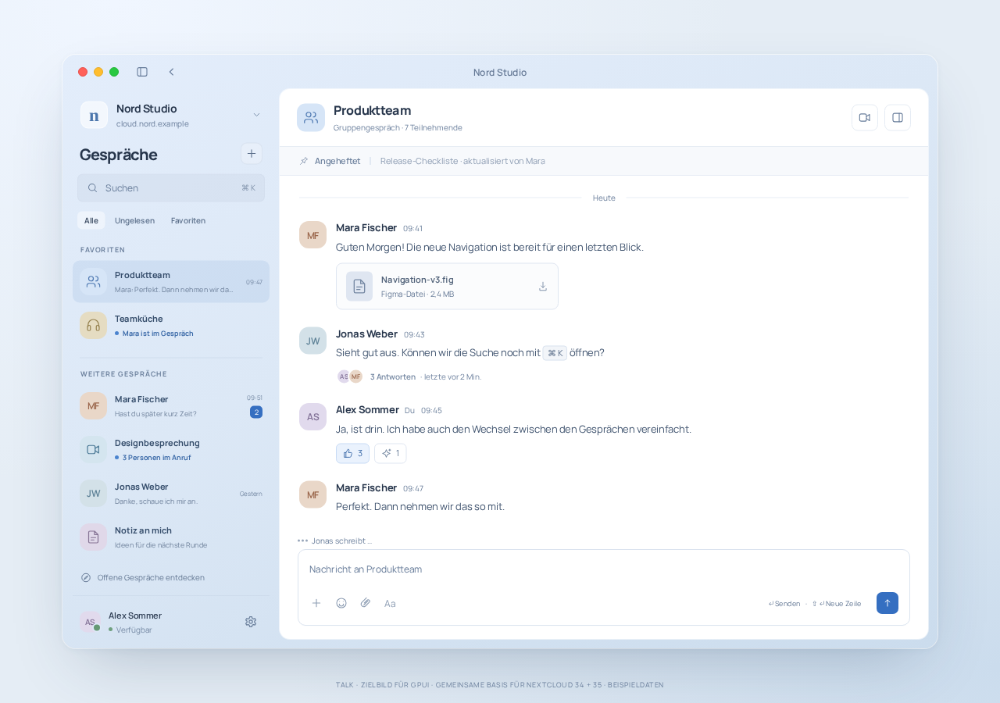

# Design reference

These references describe the visual and interaction targets for the native Rust/GPUI application, with macOS as the primary platform and no embedded WebView. Browser-rendered mockups do not demonstrate native rendering, server integration, accessibility conformance, or performance.

Blue is the preferred direction. Sage is retained for comparison. Both use Manrope, shared geometry, fictional people and messages, and CSS-drawn media placeholders. UI examples are German; public documentation is English.

| Read | Purpose |
| --- | --- |
| [Principles](principles.md) | Stable design rules, conversation semantics, native behavior |
| [Tokens](tokens.md) | Palette, typography, alignment and accessibility targets |
| [Flows and screen map](flows.md) | Stable screen/flow IDs, acceptance criteria, screenshot links |
| [Conversation dialogs](conversation-dialogs.md) | Header actions, members/bots and five-tab room settings; [interactive design](prototypes/conversation-dialogs.html) |
| [Artifact provenance and checks](artifacts.md) | What was copied or revised, reproducible review, limits |
| [Project notices](../../NOTICE.md) | EUPL scope and the separate Manrope font license |

Product feature specifications govern scope and supported behavior. These Markdown documents govern the design interpretation of the supporting assets. HTML, screenshots, synthetic capability profiles and historical comparison notes are evidence of design intent only. Resolve conflicts in that order; a screenshot must never expand a feature or permission claim.

## Current direction

[Compare the sage workspace](assets/sage/05-chat.png). The native implementation must apply the readability targets in [tokens.md](tokens.md), including improvements over small or low-contrast labels in retained sketches.

## Call entry decision

- Incoming **direct** colleague call: `D-S13` → **Annehmen** → `D-S19`, a call with Mara and Alex. No conference device-prejoin interstitial.
- Conference/webinar/presentation: conversation → `D-S09`, **Bereit, wenn du es bist.** → **Jetzt teilnehmen** → required gates → `D-S10`.
- Huddle/ordinary group: deliberate headphone action → required gates → connecting/joined call, without a generic device-prejoin page. Teamküche selection still opens only `D-S20`; the explicit join leads to `D-S18`. Actual Channel presets forbid calls. Older Teamküche-prejoin sketches are historical, not the current target.
- OS permissions, required recording consent and security policy remain gates in either flow. Ringing alone never activates microphone or camera.

See [D-F03](flows.md#d-f03-accept-a-direct-call) and [D-F04](flows.md#d-f04-voluntarily-join-a-conference) for acceptance criteria. Incoming calls do not require a device-preview step.

## Supporting assets

The [gallery](prototypes/index.html) contains **20 views per palette**: four account, nine conversation and seven call views. Counts in both galleries come from their screen data. Download the repository and open it locally; GitHub's source viewer does not execute HTML. The editable [blue mockup](prototypes/blue/ui-sketch.html) and [sage mockup](prototypes/sage/ui-sketch.html) are self-contained. Add `?review` to expose the screen selector, or `?screen=incoming`, `?screen=direct-call`, or `?screen=prejoin` to select a view. `?screen=voice-room` opens the new conversation; `?screen=prejoin&conversation=voice` or `&conversation=design` selects a contextual device check. Back returns to that conversation. Voice/direct sharing controls remain illustrative; only the four-person conference has a sharing sequence.

The mockups perform local screen navigation only. Device selectors, messaging, authentication, consent, capture and media controls are illustrations. They make no Nextcloud calls. Their use of HTML is an authoring aid, not an application architecture choice.

The support targets are Nextcloud 34.x / Talk 24.x and Nextcloud 35.x / Talk 25.x. Controls depend on capabilities, configuration, conversation state and effective permissions; the version labels in the creation examples are synthetic fixtures, not feature switches.
